<p align="center">
  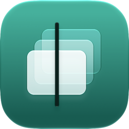
</p>

<h1 align="center">Remind</h1>

<p align="center">
  <strong>Find anything you've seen on your Mac.</strong>
</p>

<p align="center">
  Remind records your screen in the background, reads the words on it, and lets you search for them or scroll back to any moment.<br>
  Recordings are encrypted and stay on your Mac.
</p>

<p align="center">
  macOS 26 or later · Apple Silicon · No account · No analytics · No cloud
</p>

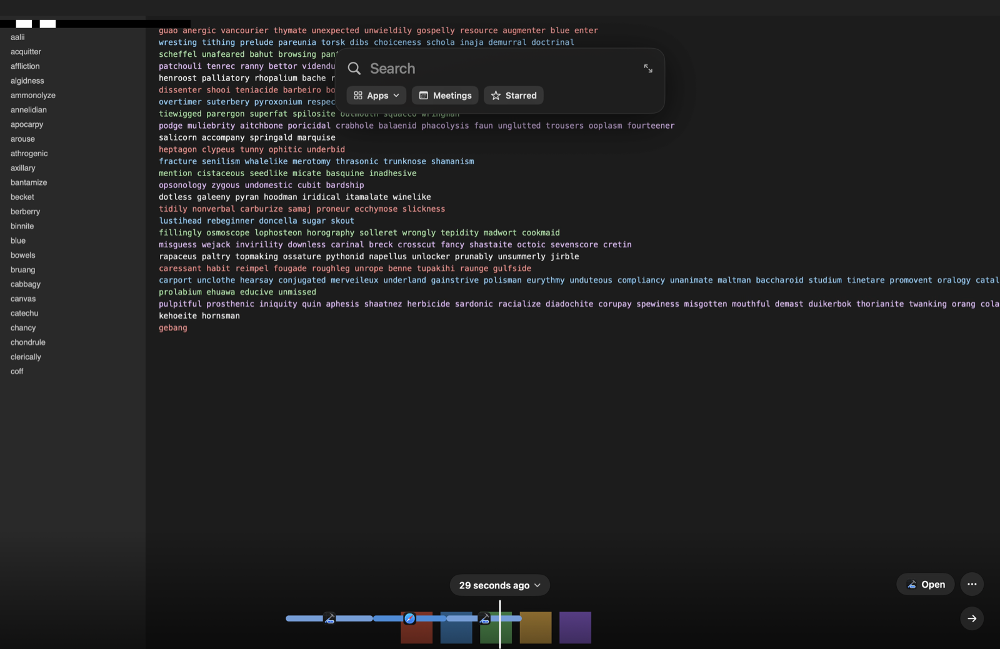

<p align="center"><sub>All screenshots show synthetic test data.</sub></p>

> [!IMPORTANT]
> **Remind is pre-release software, at version 0.1.0.** There's no download yet, so the only way to run it is to build it. The name and bundle ID aren't final, and some checks are still open, including whether the timeline stays hidden on a real call. See [Status](#status) and [Known limitations](#known-limitations).

## Contents

- [What it does](#what-it-does)
- [Status](#status)
- [Getting started](#getting-started)
- [Using Remind](#using-remind)
  - [The timeline](#the-timeline)
  - [Working with a stretch of time](#working-with-a-stretch-of-time)
  - [Search](#search)
  - [Ask](#ask)
  - [Daily Recap](#daily-recap)
  - [Meetings and transcripts](#meetings-and-transcripts)
  - [Controlling what's recorded](#controlling-whats-recorded)
- [Keyboard and gestures](#keyboard-and-gestures)
- [Settings](#settings)
- [Shortcuts, links, and Control Center](#shortcuts-links-and-control-center)
- [Privacy and security](#privacy-and-security)
- [How it works](#how-it-works)
- [Measurements](#measurements)
- [Developing Remind](#developing-remind)
- [Troubleshooting](#troubleshooting)
- [Known limitations](#known-limitations)
- [Documentation](#documentation)
- [Built with](#built-with)
- [Licence](#licence)

## What it does

You saw it somewhere: a figure in a spreadsheet, an error message, a flight time, a page you closed last Tuesday. Remind keeps a private, searchable history of your screen, so you can get it back by typing a word you remember or by scrolling back to the moment.

| | |
|---|---|
| **Timeline** | Scroll back through your screen in a full-screen overlay that opens without switching apps. Select any stretch on the strip to star, export, or delete it. |
| **Search** | The words on your screen are read and indexed on your Mac. A result takes you to the moment they were on screen, with the match outlined. |
| **Ask** | Ask a question in plain language. Apple's on-device model answers from your recordings and cites the moments it used. |
| **Daily Recap** | See where a day went: time per app, activity by the hour, your longest stretches, and your meetings. |
| **Meetings** | Optionally transcribe your microphone and your computer's audio, labelled You and Others, and search it alongside your screen. The audio itself isn't kept. |
| **Privacy** | Recordings are encrypted. You can exclude apps, private browser windows are left out, and the only network use is an update check you can turn off. |

Capture, encoding, text recognition, search, transcription, and answers all run on your Mac.

## Status

| | |
|---|---|
| **Version** | 0.1.0, unreleased |
| **Download** | None yet. Build from source. |
| **Name** | A working name. "Remind" is also used by a school-messaging app, and it needs a trademark check. |
| **Bundle ID** | `app.remind.Remind.dev` is a placeholder. |
| **Updates** | Sparkle is wired in, but builds have no updater until a feed and signing key are set. |
| **Tested on** | Benchmarks have only run on an M4 Max with synthetic screens. See [Measurements](#measurements). |
| **Licence** | [MIT](LICENSE) |

[docs/release-checklist.md](docs/release-checklist.md) lists everything left to do before a public release.

## Getting started

### Requirements

To run Remind:

- A Mac with Apple Silicon
- macOS 26 or later
- Apple Intelligence, only if you want written answers in Ask and meeting summaries. Everything else works without it.

To build it:

- Xcode 27
- Rust 1.99 or later
- [XcodeGen](https://github.com/yonaskolb/XcodeGen) (`brew install xcodegen`)
- An Apple Development signing identity

### Build and run

```sh
git clone git@github.com:19h/Remind.git
cd Remind
```

Set `DEVELOPMENT_TEAM` in `project.yml` to your own team ID. Debug builds use your Apple Development identity on purpose: macOS ties permission grants to the signature, so a real identity keeps them across rebuilds.

```sh
make app
open build/Derived/Build/Products/Debug/Remind.app
```

`make app` builds the Rust core, generates its Swift bindings, generates the Xcode project, and builds the app. To work in Xcode, run `make project` and open `Remind.xcodeproj`. The project and the core's framework are generated, so neither is checked in.

> [!WARNING]
> A development build is the real app. Once you finish setup, it records your actual screen into `~/Library/Application Support/app.remind.Remind.dev/vault`. To check a build without recording anything, run `make self-check`, which opens a temporary vault, prints the core's versions, and exits.

### First run

Setup explains what Remind is and how it works, then asks for permissions:

| Permission | | What it's for |
|---|---|---|
| Screen Recording | Required | Takes a picture of your screen every few seconds. |
| Accessibility | Required | Reads the front window's title and web address, spots private browser windows, and lets the ⌘⇧ scroll gesture take over from the app underneath. |
| Microphone | Optional | Transcribes meetings you choose to record. |
| Calendar | Optional | Names meetings. It's only requested when you turn this on in Settings → Meetings. |

macOS only applies a new Screen Recording grant to new processes, so Remind offers to reopen itself and comes back at the same step. You can also leave setup and return later, because Remind keeps your place and the menu bar offers **Finish setting up Remind…**. macOS also asks you to confirm screen recording from time to time. If recording stops, the menu bar icon tells you.

The last step shows the three things worth remembering, and **Start recording** begins. Remind lives in the menu bar from then on. The first few times you open the timeline, three short hints show you how to scroll, search, and get back. They wait while search results or a selection are showing.

<p align="center">
  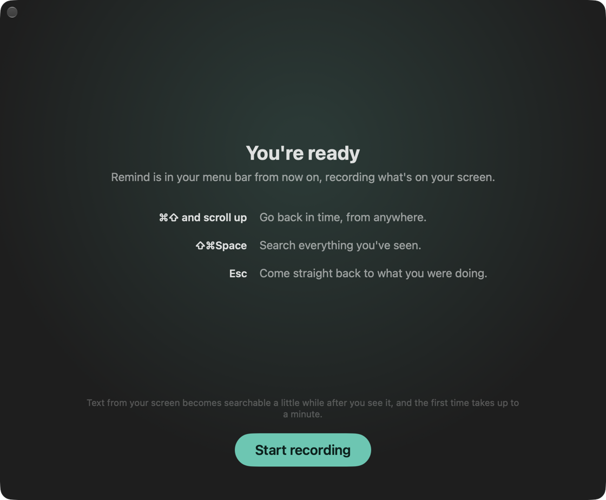
</p>

## Using Remind

### The timeline

Hold ⌘⇧ and scroll up from any app. The swipe that opens the timeline is the same one that moves through it, and it carries on after you let go of the keys and through momentum, so it looks like the screen itself going back in time. Press Esc to return to what you were doing.

The overlay opens on the display under your pointer. It never activates Remind, so the app you were using stays active, opening causes no Space or stage switch, and Esc puts you back with focus where it was. The frame reaches the screen before the window does, so there's no black flash, and the controls rise only after it.

- **Scroll or swipe** to move through time. Scrolling moves the strip under a fixed playhead, and it follows your natural scrolling setting. Hold ⌥ to go 8 times faster.
- **Pinch, or press ⌘+ and ⌘−,** to zoom the strip, from a whole day on screen down to seconds. The magnifier beside **Open** does the same with a slider.
- **The strip** shows which app was in front at each moment, in colour and with app icons, plus marks for starred moments and for when something was being transcribed. Hover over a run to see its window, when it ran, and how long it lasted, with seconds if it's under 10 minutes.
- **Stretches with nothing recorded** are left out of the strip and of scrolling. Ten hours away takes no more scrolling to cross than ten minutes: it's one short break, labelled with how long it was, such as **10h**, and the same width at every zoom. Hover over it to see exactly when it was. If scrolling stops on a break, the playhead eases onto the moment beside it. Gaps under 30 seconds stay to scale, and anything said counts as recorded, even while the screen stayed still.
- **The time pill** opens Jump to Date & Time. The calendar and hours dim wherever nothing was recorded, or you can type a phrase such as "yesterday 3pm" or "March 4". A phrase with no year or day means the most recent time it happened. A time with nothing recorded lands on the nearest moment that has something.
- **Open** goes back to the app you were in, or reopens the page in the same browser.
- **The arrow at the end of the strip** returns to now, or to your last recording if that was more than 30 seconds ago. That's also where the timeline opens, with the time pill showing when it was.
- **The display picker** appears when more than one display has recordings. Recording follows your pointer, so each display has its own history, and you can look through any of them from where you are. A recording from a display of another shape sits in the middle, with bars at the sides or above.

<p align="center">
  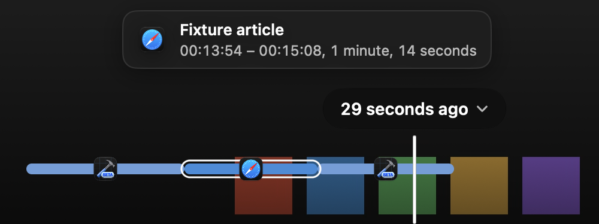
</p>

<p align="center">
  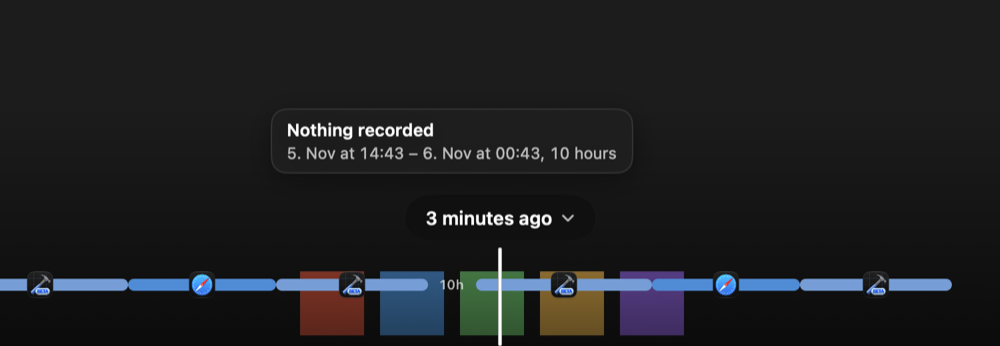
</p>

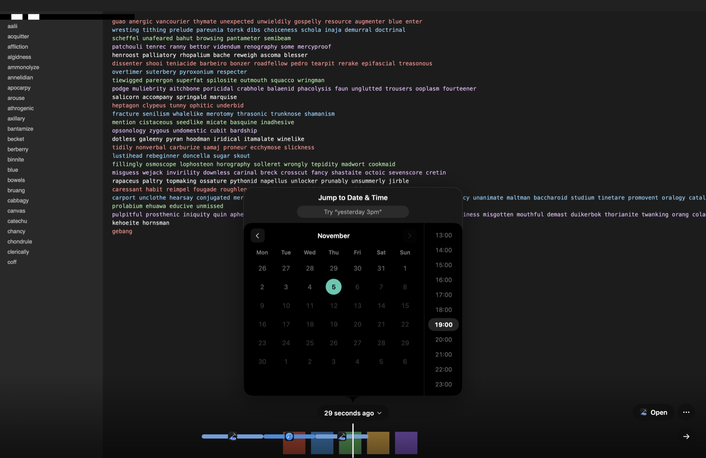

**Text on a frame is live.** The pointer becomes an I-beam over recognised text. Drag to select lines, then press ⌘C. With nothing selected, ⌘C copies all the text on the frame, and ⌘⇧C copies the frame as an image.

**A frame can be dragged out.** Drag anywhere that isn't text to drop the frame into Finder or another app as a PNG. That temporary copy is unencrypted, so it's deleted about a minute after the drop.

The **⋯** menu holds everything else:

| Action | What it does |
|---|---|
| Star moment, Remove star | Marks the frame, so the Starred search filter finds it and the strip shows it. |
| Save image…, Copy image | Saves the frame as a PNG, or copies it. |
| Copy text | Copies the selected lines, or the whole frame's text. |
| Copy link to this moment | Copies a [`remind://` link](#moment-links). |
| Export 5 minutes as video… | Saves the 5 minutes around the playhead as an MP4. To choose exactly what to export, select it on the strip. |
| Screen capture, Audio capture | The same switches as in the menu bar. |
| Exclude this app from recording | Leaves the app out of recording from now on, effective at once. |
| Forget the last 5 minutes… | Permanently deletes the 5 minutes before now, wherever the playhead is. It asks first. |
| Settings… | Opens Settings. |

<p align="center">
  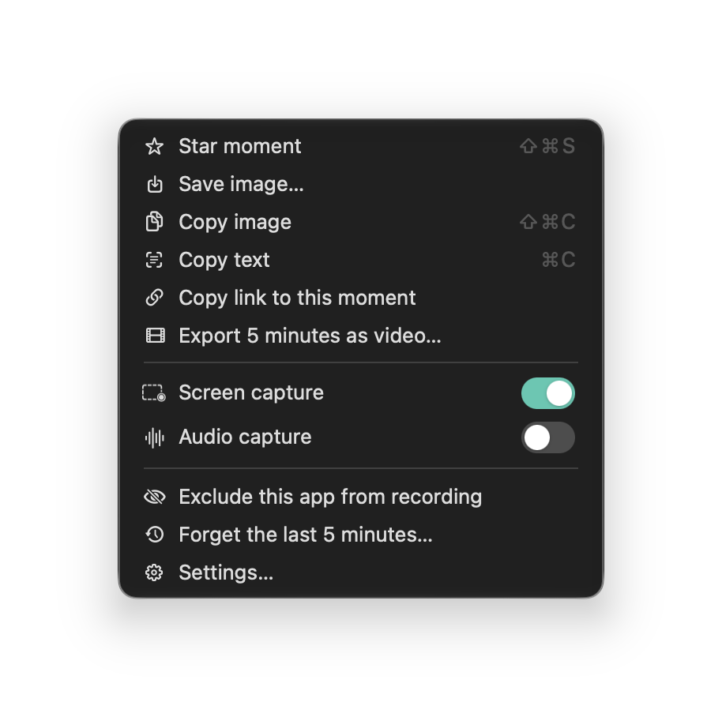
</p>

### Working with a stretch of time

The strip is also where you manage your history. Click a run to go to that moment and select the whole run. Drag to select any stretch, and drag either end of a selection to trim it. The ends snap to where an app starts or stops, because a stretch that ends where an app ends takes nothing from the next one. A selection can reach across a break, and its length counts only what was recorded. Esc clears the selection.

<p align="center">
  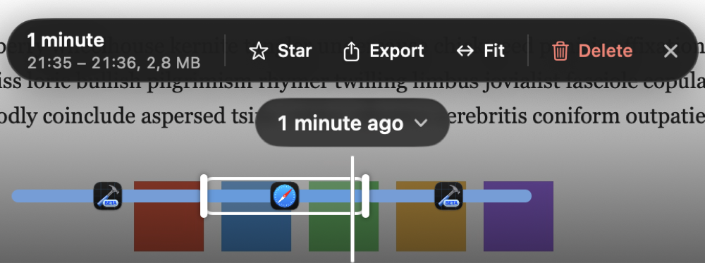
</p>

| Action | What it does |
|---|---|
| Star | Stars the first frame of the stretch, so the Starred filter finds it. |
| Export | Saves exactly that stretch as an MP4, without re-encoding. This is an unencrypted copy, and the save panel says so. A still screen that lasted over a minute is cut to a second. If the display changed resolution partway, the video stops there and tells you. An existing file is only replaced once the new one is complete. |
| Fit | Zooms the strip so the selection fills it. |
| Exclude *app* | Appears when the stretch is all one app, and leaves that app out of recording from now on. |
| Delete | Permanently deletes the stretch, after telling you exactly what will go. The Delete key does the same. |

**Deleting says what it will do first.** The confirmation gives the size, and says if any starred moments or speech go with it. It also names any time just after the stretch that has to go too, because those frames can't be shown without it. Each app starts on a keyframe, so removing a whole run of one app takes nothing from the next.

<p align="center">
  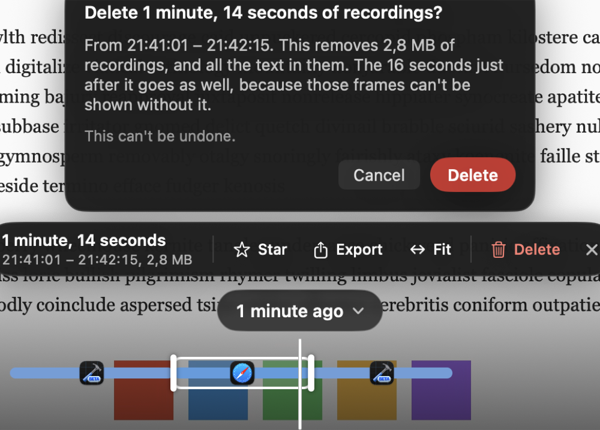
</p>

### Search

Press ⌘⇧Space from anywhere, or start typing while the timeline is open. Opening by scrolling leaves the frame clear, so the search panel only appears once you ask for it. Results appear as you type.

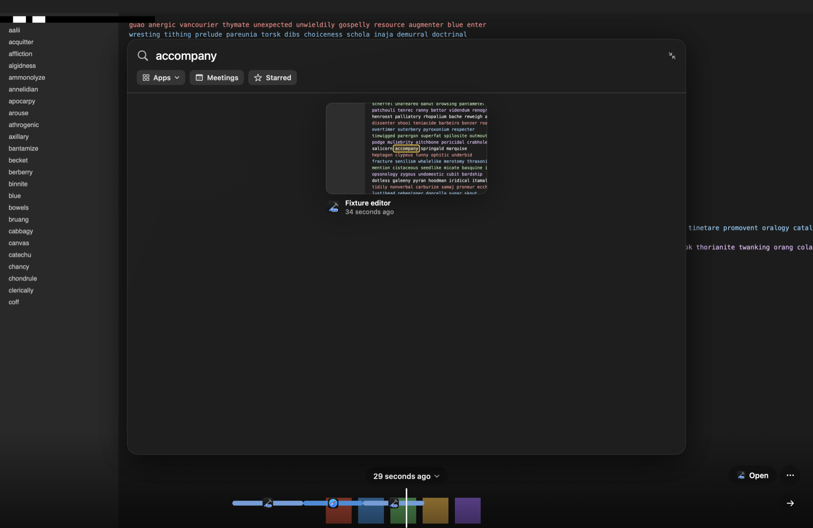

Each result is a crop of the frame centred on the match, with the window title and the time. Click one to go to that moment, with each match outlined and numbered, even if it was on another display. Esc takes you back to the results. Hover over it for **Open in** the app it came from. Something that was said, rather than shown, appears as the words themselves, and choosing it opens its transcript.

**You can keep your hands on the keyboard.** ↑ and ↓ move between rows, Tab and ⇧Tab move one result at a time, and Return goes to the chosen result, or the top one if you haven't moved.

| Type this | To find |
|---|---|
| `quarterly review` | Moments showing both words. Every word has to match. |
| `rev` | Words starting with this. The last word matches as a prefix while you're still typing it, so this finds `review` and `revenue`. |
| `running ` | Other forms of a finished word, such as `run` and `runs`. A space or another word after it marks it finished. Word forms are English. |
| `"quarterly budget"` | The words next to each other on one line. A phrase can't match across two lines. |
| `cafe` | `Café`. Case and accents don't matter, and `strasse` finds `Straße`. |
| `example.com` | `example` followed by `com`. Punctuation separates words. |
| Chinese, Japanese, Korean | Text with no spaces is indexed in overlapping pairs of characters. |

There are no operators: `OR`, `NOT`, and `*` are treated as text.

Three filters narrow a search:

- **Apps** limits it to the apps you pick.
- **Meetings** limits it to what was said.
- **Starred** limits it to frames you've starred.

<p align="center">
  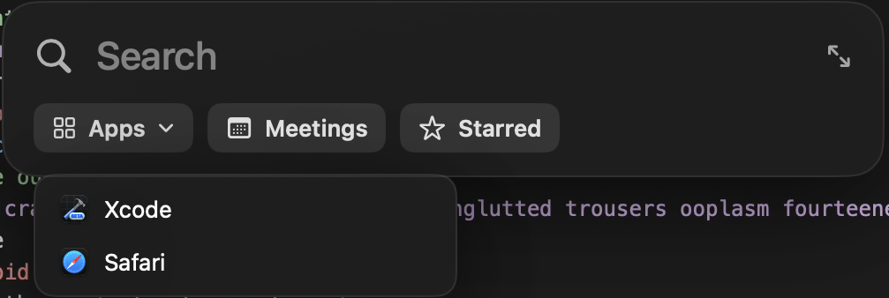
</p>

**Filters work without any words.** Turn one on with the search box empty to browse, most recent first: your starred moments, your past meetings, or the latest from some apps. This is how to find something when you can't remember a word from it.

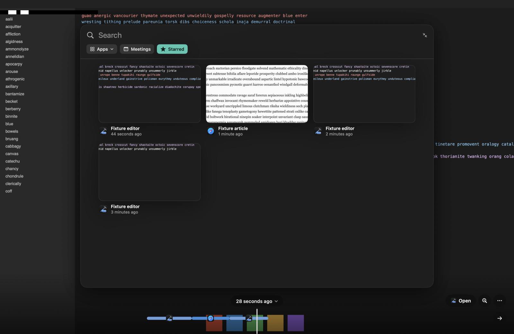

**Ranking.** A match in the window title ranks above one in the front window, which ranks above one elsewhere on screen. The newest 5,000 matches are ranked by relevance, and older ones follow, newest first, so every match stays reachable. Words rarer than that are ranked across all of your history.

**Every result is a real moment.** To save space, the index merges frames that show nearly the same text, so two words might share a document without ever being on screen together. Each hit is checked against individual frames before you see it.

### Ask

Press ⌥⇧Space and ask something like "Where did I see the budget numbers?"

1. **Planning.** Your question becomes search terms, with no model involved. Filler words are dropped in English and German, quoted phrases stay whole, and "yesterday", "today", "last week", "last month", or a date limits when to look.
2. **Finding.** It searches for all the words together, then each alone, and collects up to 16 moments. A question with nothing specific to look for, like "What did I do today?", takes moments spread evenly through what happened in that time instead, or today if it doesn't say when.
3. **Answering.** As many excerpts as fit go to Apple's on-device model, which is told to answer only from them and to cite each fact. A question about a whole period has no single answer to find, so the model is also told that the excerpts are samples of that time and asked to describe them.
4. **Citing.** Citations such as [2] link to the moment they came from. Only sources that exist become links, because a model can invent a number.

<p align="center">
  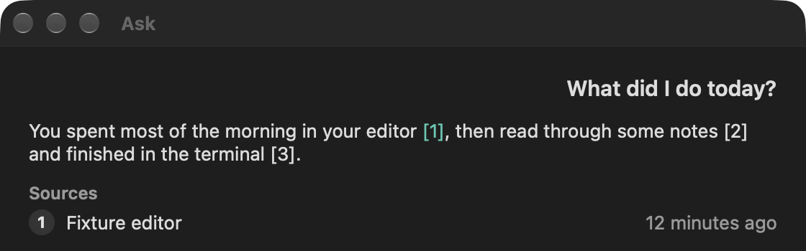
</p>

**It works without the model.** If this Mac isn't eligible, Apple Intelligence is off, the model is still downloading, or it declines to answer, you still get the matching moments and a note saying why.

**Text on your screen can't give it orders.** Anything can appear on a screen, including text written to look like instructions. The model has no tools, it's told that excerpts are data, and those excerpts can't break out of their place in the prompt. The worst a hostile page could do is mislead an answer, so check the citations when it matters.

Each question is answered on its own, with no memory of earlier ones. Ask never uses a cloud model, and a build check enforces that.

### Daily Recap

Open **Daily Recap** from the menu bar, or give it a shortcut in Settings. It's worked out from your local data, with no model involved, and shows one day at a time:

- Total time on screen, and activity by the hour
- Your top 8 apps, with time in each
- Your 10 longest stretches of at least 5 minutes. Click one to go to that moment.
- The meetings you transcribed. Click one to read its transcript.

<p align="center">
  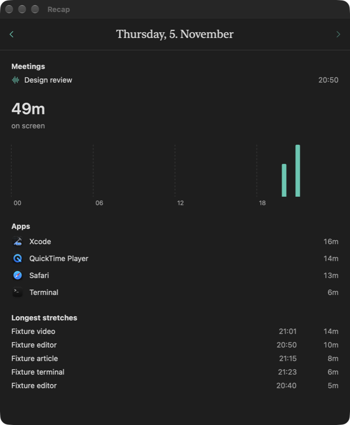
</p>

### Meetings and transcripts

Remind checks for a call every 5 seconds, including windows on other Spaces and minimised ones. It recognises Zoom, Slack huddles, Webex, and the Microsoft Teams app, and Google Meet, Zoom, and Teams in a browser. A browser call is recognised from the address of the front tab, which Remind only reads while your microphone is in use. Once it's recognised, switching tabs doesn't end it, but the microphone being let go does. What happens next is up to you, in Settings → Meetings:

- **Ask me**, the default, because recording other people is a decision to make each time
- **Record automatically**
- **Don't record**

<p align="center">
  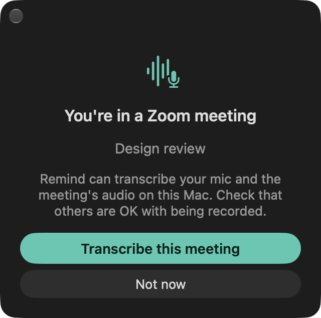
</p>

About 30 seconds after a call's signs disappear, transcription stops by itself. You can also start or stop it at any time with the **Audio capture** switch in the menu bar. Firefox doesn't expose its web address, so use the switch for calls there.

**How transcription works.** Apple's speech framework transcribes on your Mac, and macOS downloads each language the first time it's used. Audio is never written to disk. The microphone and your computer's audio are transcribed separately, which labels each line **You** or **Others**. When your microphone picks up the call from your speakers, a word is dropped only if the same word came from the speakers at around the same moment. What you say over someone else is kept, unless it's that same word. Sound from apps you've excluded stays out too. If the microphone isn't allowed, Remind transcribes only your computer's audio and tells you.

**Afterwards.** What was said is searchable alongside your screen, and the Meetings filter narrows to it. **Transcripts** in the menu bar lists every transcript, most recent first. Words appear a few seconds after they're said, and a recent transcript keeps catching up while it's open. Click a line to go to that moment on the timeline, or use the Details tab to summarise the meeting on your Mac. A long meeting is cut to what fits the model.

<p align="center">
  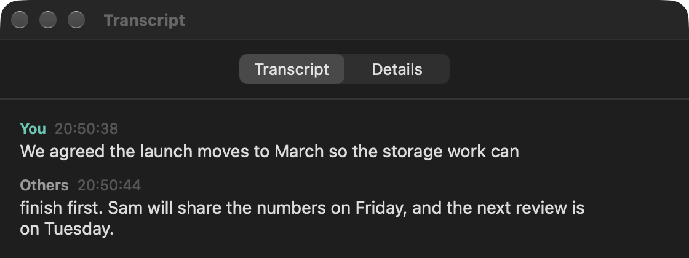
</p>

**Calendar names** are off by default. When you turn them on, Remind reads the event in progress, or one starting within 5 minutes, and keeps only its title with the transcript.

> [!NOTE]
> Laws on recording conversations differ by place, and many require everyone's consent. Getting consent is up to you.

### Controlling what's recorded

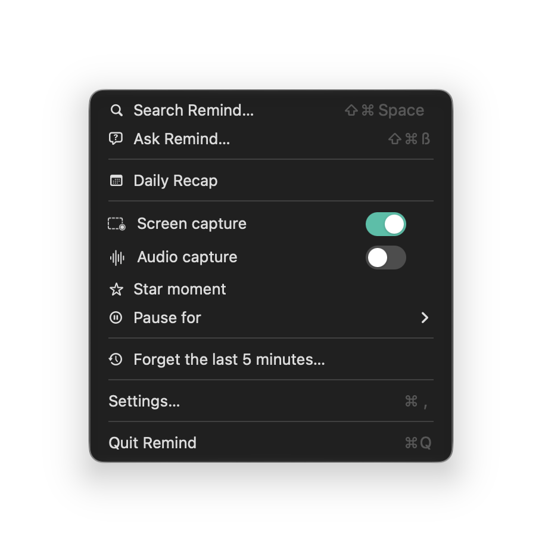

The menu bar icon shows what's really happening. A filled frame means recording, an outline means paused or not recording yet, and a line through it means there's a problem, which the menu explains. Three extra bars mean audio is being transcribed.

- **Pause** with the Screen capture switch, for 15 minutes or an hour, or from Shortcuts or Control Center. A pause carries on if Remind restarts. If you pause with no end time, a card reminds you every hour, and you can turn that off in Settings.
- **Star moment** stars the next frame, even if the screen hasn't changed.
- **Exclude an app** in Settings → Screen, or from the timeline's ⋯ menu. It takes effect at once.
- **Forget the last 5 minutes** from the menu bar or the timeline. It's permanent, so it asks first.
- **Set how long to keep recordings** in Settings → Storage.

Remind also adjusts by itself:

- It stops recording and transcribing when your Mac sleeps or locks, and starts recording again afterwards.
- If recording stops unexpectedly, it says why and tries again about every 30 seconds.
- It records the display your pointer is on, and moves once the pointer has stayed on another display for 2 seconds.
- In Low Power Mode, it captures every 4 seconds instead of every 2.
- When your Mac runs hot, text recognition pauses. Capture carries on, and frames wait safely in the log.

<br clear="right">

## Keyboard and gestures

**From anywhere**

| Input | Action |
|---|---|
| ⌘⇧ and scroll up | Open the timeline. |
| ⌘⇧Space | Open search. |
| ⌥⇧Space | Open Ask. |
| Open Remind again while it's running | Open search, or setup or the recovery key if they need you first. |

You can change the two key combinations in Settings → Shortcuts. A default is saved the first time it's used, so a Mac that ran an earlier build keeps ⌘⇧- for Ask until you change it there. You can also assign shortcuts there for Daily Recap, Star moment, and Audio capture, which have none by default.

**In the timeline**

| Input | Action |
|---|---|
| Scroll or swipe | Move through time. |
| ⌥ and scroll | Move 8 times faster. |
| Pinch, or ⌘+ and ⌘− | Zoom the strip. |
| ← → | Go to the previous or next frame. |
| ⌥← ⌥→ | Go to the previous or next stretch in an app. Going back first returns to the start of the current one. |
| End | Go back to now. |
| Start typing, or ⌘F | Search. |
| Return | Open the app or page from this moment. |
| ⌘C | Copy the selected text, or all the text on the frame. |
| ⌘⇧C | Copy the frame as an image. |
| ⌘⇧S | Star this moment, or remove its star. |
| Delete | Delete what's selected on the strip, after asking. |
| Esc | Back out one level: a panel or confirmation, the selection, the zoom slider, the app list, back to the results, the search text, the search panel, then the timeline itself. |
| ⌘Q, ⌘W | The same as Esc, so they can't quit the recorder while the overlay is up. |

**In search**

| Input | Action |
|---|---|
| ↑ ↓ | Move between rows of results. |
| Tab, ⇧Tab | Move to the next or previous result. |
| Return | Go to the chosen result, or the top one. |

While the search field has focus, ← →, Delete, and ⌘C go to the field instead.

The overlay also closes by itself when you switch Spaces or apps, when the screen sleeps or locks, and when displays change.

## Settings

| Tab | Setting | Default | Notes |
|---|---|---|---|
| General | Open Remind at login | Chosen during setup | It comes back after a crash, but not after you quit. If macOS is waiting for you to allow it, this says so and links to Login Items. |
| | Remind me when recording is paused | On | Hourly, for pauses with no end time. |
| | Show in Dock | Off | |
| | Check for updates automatically | On | Only appears in builds with an updater. |
| Screen | Exclude apps | None | Choose from installed or running apps, or add one with **+**. |
| | Don't record private or incognito browser windows | On | Warns here if it can't check right now. |
| | Text recognition | Standard | Standard reads the languages your Mac uses. Additional languages detects any language, and uses more system resources. |
| Audio | Transcription language | Your Mac's language | Uses the closest supported language. |
| | Record | Microphone and speaker audio | Or microphone only, or speaker audio only. |
| Meetings | When a meeting is detected | Ask me | Or record automatically, or don't record. |
| | Name meetings from your calendar | Off | Requests calendar access when you turn it on. |
| Storage | Keep recordings for | Forever | 1 week, 1 month, 3 months, 6 months, 1 year, or forever. Whole days are removed, and starred moments aren't kept any longer than the rest. Shortening it asks before deleting anything. |
| | Space used | | Shows the total, an estimate per day from your own recordings, and free disk space. |
| | By app | | Shows how much each app takes up, with a button to delete everything recorded from it. Remind keeps recording that app unless you exclude it. |
| | Recovery key | | Saves a file that can restore your recordings if the key is lost. Remind reminds you once, a week after first run. See [If the key is lost](#if-the-key-is-lost). |
| | Location | | Shows the vault in Finder. |
| | Delete a time range… | | Deletes screen recordings and transcripts from the times you pick. You can also select a stretch on the timeline. |
| | Delete all recordings… | | Deletes your screen recordings and transcripts. It can't be undone. |
| Shortcuts | Search, Ask, Daily Recap, Star moment, Audio capture | | |

## Shortcuts, links, and Control Center

### Shortcuts and Siri

| Action | Input | Siri phrase |
|---|---|---|
| Search Remind | | "Search Remind" |
| Go to a moment in Remind | Date and time | |
| Pause Remind recording | Minutes, optional. Leave it empty to pause until you resume. | "Pause Remind" |
| Resume Remind recording | | "Resume Remind" |

### Moment links

`remind://moment/<milliseconds since 1970>` opens the timeline at that moment:

```sh
open "remind://moment/1800000000000"
```

**Copy link to this moment** in the ⋯ menu makes one for you. These links come from outside the app, so anything malformed is ignored, and a link can only say where to look.

### Control Center

Add the **Remind recording** control to Control Center or the menu bar. It's a switch that shows whether Remind is recording, and turning it off or on pauses or resumes. It says **Not recording** whatever the reason, whether that's a pause, a problem, or Remind not running. It can only ask, so turning it on doesn't start Remind if it isn't running.

The switch runs in a separate sandboxed process, so it shares only system notifications with the app: one name to ask for a pause, one to ask to resume, and a number on a third that says what's true. The system forgets that number when Remind stops, so a crash can't leave the switch claiming to record.

## Privacy and security

**Remind keeps everything on your Mac.** It has no account, no analytics, and no crash reporting. It doesn't upload your recordings, text, or transcripts anywhere. [docs/PRIVACY.md](docs/PRIVACY.md) is the full statement. This is a summary.

| | |
|---|---|
| **Recorded** | A picture of the display your pointer is on, about every 2 seconds when it has changed. The text on it. The app, window title, and web address of what's in front. A transcript, if you turn that on. |
| **Left out** | Apps you exclude, and their sound in a transcript. Private and incognito browser windows. Remind's own windows. The audio behind a transcript. |
| **Not protected** | **Password fields and other sensitive content in ordinary windows do get recorded if they're visible.** Exclude any app you don't want recorded. |
| **Read to work** | Scroll events, with Accessibility on, so ⌘⇧ and scrolling up can take over from the app underneath. It sees scroll events only, never the keyboard, and passes along everything except that gesture. While your microphone is in use, the front browser tab's address, to recognise a call. With calendar names on, the title of the event happening now. |

### Encryption

| What | How |
|---|---|
| Recordings | ChaCha20-Poly1305. Each chunk file has its own key, derived with BLAKE3. |
| Database, including all text and transcripts | SQLCipher, with a key derived with BLAKE3. |
| Master key | Random, 256-bit, in your login keychain. A key is only created for a vault that doesn't exist yet. |
| Backups | The vault is excluded from Time Machine, because a backup couldn't be read without the key anyway. |

Chunk files are stored by random ID rather than by date, so the folder layout doesn't reveal when you were active.

### If the key is lost

A recovery key is the only way back if the key in your keychain is ever lost. Settings → Storage saves one to a file, and Remind reminds you once, a week after first run.

If recordings exist but their key doesn't, Remind asks for it. Enter the key or choose the file you saved. It only goes back in the keychain once it has been shown to open these recordings, so a wrong key can't do any harm. With no recovery key, **Start over…** deletes the recordings, because they can never be read without it.

<p align="center">
  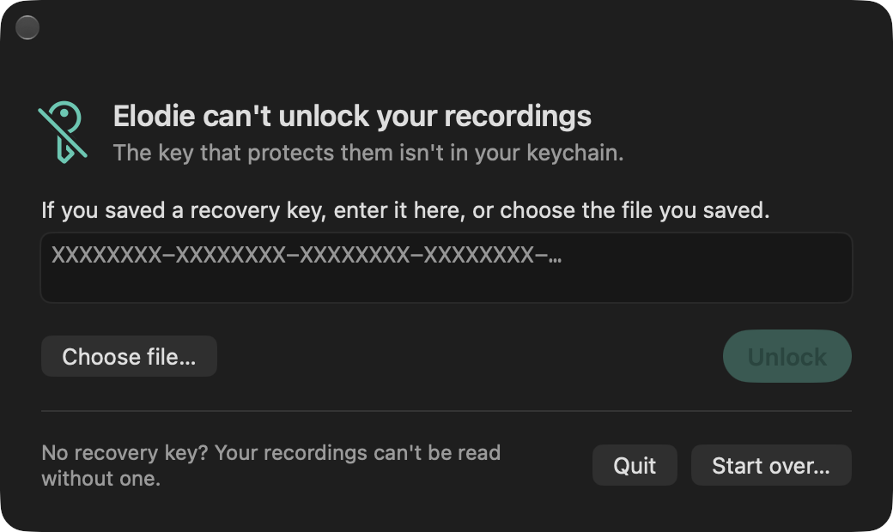
</p>

### Private windows

Browsers offer no API for this, so Remind recognises private windows from their titles, in 16 languages. Arc also marks them in a way that doesn't depend on language. A browser is recognised by how it's built rather than from a fixed list, so new and renamed Chromium browsers are covered.

**When in doubt, a frame is dropped.** A frame is kept only if the capture filter in effect when it was composed already hid every window that must be hidden. While a new private window is on its way into the filter, frames are thrown away. A browser window with no title yet counts as private until it has one. If a browser doesn't answer within 50 ms or gives an error, that frame is dropped too, and Settings tells you if it keeps happening.

**Remind also watches between frames.** Frames only arrive every couple of seconds, which leaves time for a private window to open and close unseen. So it looks at the window list every 0.2 seconds, and usually has the filter updated before the next frame is composed. It does this on a strict timer at a higher priority, and App Nap can't slow it. A new filter is only trusted after 0.25 seconds, because updating one returns a few milliseconds before frames stop showing what it hides. If a window that must be hidden closes before any filter covered it, everything composed up to that moment counts as unsafe.

**A late look makes frames unsafe too.** A busy Mac can't always keep to that timer. If more than 0.25 seconds pass between looks, nothing composed in that time can be vouched for, so those frames are dropped. The same happens if a window closes between the two reads of the list, because then there's no telling what it was. A busy Mac may lose a few frames this way. A private window open for less than 0.25 seconds may still go unseen and reach a recording, and [Measurements](#measurements) has what testing found.

### What it can't protect you from

- **Your own account.** Anyone who can use your Mac while you're logged in can open Remind and see your history.
- **Other apps on your Mac.** The Control Center switch talks to Remind through system notifications, and any app can use them too. Another app can see whether Remind is recording, and can ask it to pause or resume. It can't read your recordings this way.
- **Copies you make.** Exported videos, saved images, and dragged frames aren't encrypted. A saved recovery key can decrypt everything, so keep it somewhere safe.
- **Deleted blocks.** Deleting removes recordings and their text from Remind's files, and a few frames just after a deleted period also go, because they can't be decoded without what came before. Like any file deletion, old encrypted blocks can stay on the drive or in APFS snapshots until they're overwritten.

### The network

Remind uses the network for one thing: Sparkle's update check, which you can turn off. It's limited to `App/Updater.swift`, and a build with no update feed and signing key doesn't run it at all. macOS downloads its own language models for transcription and Ask, and Remind sends nothing in that process.

These promises are checked against the code. `make check-privacy` runs as part of `make test` and before every release build, and it fails if:

- Anything outside Sparkle can use the network
- Sparkle is imported outside `App/Updater.swift`
- The cloud model is used
- An analytics or crash-reporting framework is imported
- The Rust core links network calls or depends on a networking crate

## How it works

Swift owns every Apple framework. Rust owns data and computation, and it never calls Swift. Feature code sees only the `RemindCore` protocol, so previews and tests can run on a fake.

```text
  App/                 menu bar, overlay coordination, keychain, updater, intents
   │
   ├── Feature*        Timeline, Search, Ask, Recap, Meetings, Onboarding, Settings
   ├── OverlayShell    the panel and its input            StripRenderer  the Metal strip
   ├── FrameEngine     scrubbing, decoding, MP4 export    DesignSystem   colours, chrome
   ├── Ingest          change check, encoder, OCR         Capture        streams, exclusions
   ├── Audio           transcription, meeting detection
   │
   └── CoreAPI         the RemindCore protocol
        ├── CoreFake   a stand-in for previews and tests
        └── CoreLive ──▶ CoreABI ──▶ RemindCoreFFI.xcframework
                                        │  UniFFI
  ──────────────────────────────────────┼───────────────────────────────────
  core/ (Rust)                          ▼
                                       ffi      the API Swift calls
                                        │
                                      engine    write path, recovery, deletion
                                        │
             ┌──────────────┬───────────┴──┬──────────────┐
           vault          store          search        timeline
       encrypted log   SQLCipher, FTS5      │         strip, recaps
                            │               │
                            └──── text ─────┘
                              tokenizer, runs
```

### The path a frame takes

1. **Capture.** A low-rate ScreenCaptureKit stream delivers frames at most every 2 seconds. An unchanged screen delivers nothing, and the cursor isn't captured.
2. **Change check.** A Metal shader compares the frame with the last *stored* frame at half resolution. It takes about 1,000 changed pixels to keep a frame. Comparing with what's stored, rather than the previous capture, means slow changes add up until they count. Black frames are skipped.
3. **Exclusion check.** It works out which windows must be hidden, and drops the frame unless the filter in effect already covered them. It also drops frames from any stretch when the window list wasn't read on time.
4. **Encoding.** Hardware HEVC at constant quality 0.75, with a keyframe at least every 30 frames and whenever the front app changes. The encoder holds nothing back, so a crash can't lose frames inside it.
5. **The log.** Rust encrypts the sample and appends it to a chunk file. This is the source of truth. A database row follows within a second or so, and the log never waits for it, so a stalled database can't delay a frame.
6. **OCR.** A background task reads frames back from the log with Apple's Vision framework. It holds no pixels in memory while it's behind, and it picks up where it left off after a crash. When it's more than a minute behind, frames that stayed on screen for at least 4 seconds go first, because that's what you were likely reading.
7. **Text runs.** Consecutive frames whose lines overlap the first frame's by at least 80% share one search document, for up to 5 minutes. Each frame records only which lines it shows and where.

### What's on disk

```text
~/Library/Application Support/<bundle ID>/vault/
├── vault.db                 encrypted database: frames, text, search index, transcripts
└── chunks/<ab>/<ab…>.chunk  encrypted video, named by random ID
```

A chunk holds one display's frames and is replaced at the next keyframe after 5 minutes or 64 MB. Every record is sealed with its sequence number as the nonce, so **a chunk is never reopened for writing**, because resuming after a crash could repeat a nonce. A new session always starts a new chunk. The format is documented in `core/crates/vault/src/lib.rs`.

The database is a projection of the log, and its frame records can be rebuilt by scanning the chunks. Stars, recognised text, and transcripts live only in the database. Frame IDs are never reused, because anything still holding an old ID would otherwise show a deleted frame. Giving space back rewrites the whole database, so it only happens after a big deletion.

### Search

The index is an FTS5 table with no stored content, using a custom Rust tokenizer. Each word is stored in its folded form and, if different, its English stem at the same position. Whole-word queries match the stem and prefix queries match the folded form, because `runn*` could never match a stored `run`.

A search first finds candidate runs in the index, then checks each against its individual frames to find a moment that really showed every term, and where. In testing, the index matched word pairs in runs where no single frame showed both 5% of the time, so this check matters.

### Opening the timeline

Each display keeps a panel ready, so opening only has to show it. The picture goes in before the window comes up, so the first thing to reach the screen is the frame, in the right place. The controls and strip rise a moment later, and they're hidden again on closing, so nothing from last time can flash up.

With Accessibility on, an event tap takes the ⌘⇧ swipe away from the app underneath, on its own thread so a busy main thread can't make other apps stutter. Without Accessibility, a plain monitor opens the timeline instead, but the app underneath also sees the scroll.

### Scrubbing

Scrubbing outruns decoding, so the engine always works on the latest request and skips any in between. It decodes every frame when the playhead is slow, only keyframes when it's fast, and when it stops it decodes the exact frame and then the groups on either side, so the next step is instant. It gives the hardware decoder a group's frames together, so it can work on several at once, and starts no more once a newer request arrives. The picture never blanks: until the right frame is ready, the closest cached one stays up. The cache takes 10% of memory, between 700 MB and 1.4 GB, and is freed when the overlay closes.

### When things go wrong

| Situation | What Remind does |
|---|---|
| Crash or kill | Each record goes out in a single authenticated write, so a torn one is detected and trimmed. On launch, recovery replays what the database missed. |
| Power cut | The log is flushed with `F_FULLFSYNC` every 5 seconds, which bounds the loss. Recovery removes database rows the log no longer has. |
| Repeated crashes | launchd brings Remind back after a crash. After 3 crashes in 5 minutes, it comes back paused and says why. |
| Less than 10 GB free | Reading of frames set aside for later pauses. |
| Less than 2 GB free | Recording stops and says so. It resumes by itself above 4 GB. |
| Encoder keeps failing | After 3 failures in a minute, capture stops and says so. Raw frames are never stored instead. |
| A frame crashes OCR | An attempt is recorded before OCR runs, so a frame is given up on after 3 tries rather than crashing every launch. |
| Keychain locked | Treated as temporarily unavailable, and never as missing. Remind tries again when you unlock your Mac. |
| Key missing | Remind asks for your recovery key. A new key is only created if you choose to start over, because otherwise it would orphan all recorded history. |
| A second copy of Remind | A later copy hands over to the one running and leaves. The vault is also locked to one process, because recovery treats open chunks as crash leftovers, so two at once would damage each other's recordings. |
| Recording stops unexpectedly | Remind says why, and tries again about every 30 seconds. |
| The disk refuses writes | Remind says recordings aren't being saved, which can happen long before a disk looks full. It clears once writes work again. |
| A chunk is damaged | A card says how many pieces can't be read. Everything else stays usable. |
| A delete can't finish | Remind says so, and recording carries on. |
| Quitting | Remind turns what was just said into words and seals its files first, but it never waits more than 5 seconds. |

### Design

Remind uses system Liquid Glass with its own accent, verdigris, the patina time leaves on copper (`#45C9B1` in dark mode, `#0B7F70` in light). It's distinct from system blue and from the red and orange macOS uses for recording indicators. Search matches are marked in `#FFC83D`. Animations respect Reduce Motion.

**Controls stay readable over anything.** A recorded frame can be any colour, and glass over a white page reads as pale grey. Liquid Glass also adapts any tint to what's behind it, so a tint made things worse. Control text sits on a 60% black fill under the glass instead, which took the time pill from 2.29:1 to 8.18:1 over a white page. `make scenarios` holds it to 4.5:1 on white, black, saturated, and noisy backdrops.

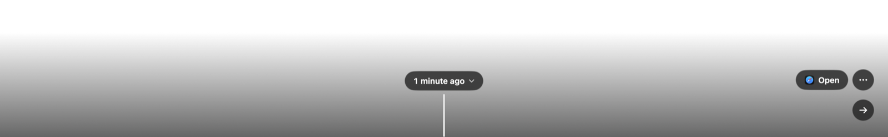

## Measurements

These come from [docs/spikes.md](docs/spikes.md), which has the full results and what each one changed.

> [!CAUTION]
> Everything here ran on an M4 Max with macOS 27.2, which flatters the numbers, and storage figures come from a synthetic screen. Remind hasn't been measured on a base MacBook Air, over a real week of use, or for energy, and the time from hotkey to first pixel isn't measured yet. Treat these as evidence about the design, not as promises about your Mac.

**Storage and seeking.** At 3024×1964, in the worst case, with all 14,400 ticks in 8 hours stored:

| Measure | Result | Target |
|---|---|---|
| Storage per 8 hours | 0.78 GB | At most 1 GB a day |
| Seek, p95 | Under 100 ms | 100 ms |
| Picture quality, mean | 49.8 dB | |
| Picture quality, worst frame | 47.4 dB | |

**Scrubbing.** From `make bench`, at 3024×1964 with a keyframe every 30 frames:

| Measure | p50 | p95 | p99 | Budget |
|---|---|---|---|---|
| Cached scrub | 0.1 ms | 0.1 ms | 0.1 ms | p95 25 ms |
| Backward miss, exact frame | 43 ms | 78 ms | 136 ms | p95 120 ms, p99 280 ms |
| Backward miss, first change | | 41 ms | | 50 ms |
| Fast flick, per update | 0.2 ms | 14 ms | 15 ms | Keeps up with 60 Hz |

The first-change row is the fully cold case, with nothing nearby in the cache, and that first change is the exact frame. It used to miss its budget, at 77 ms, until groups were decoded asynchronously, which takes a group of 30 from 45 ms to 31 ms. Only that one figure has been written down since, so the exact-frame row is from before the change.

**Text recognition.** 2,000 frames at 3024×1964, while other heavy work was running:

| Measure | Result | Target |
|---|---|---|
| Words from the live frame also read from stored video | 99.85% | At least 98.5% |
| Time per frame | p50 200 ms, p95 432 ms | p95 at most 1 s |
| Sustained at one frame per 2 seconds | About 10% of one core | At most 30% |

A clean first run spent 31 s compiling Vision's models, and a slower Mac will take longer. Later launches are quick.

**Contrast.** The time pill's text over a frame, as captured, against a gate of 4.5:1:

| Backdrop | Glass alone | Glass over a 60% black fill, as shipped |
|---|---|---|
| White | 2.29:1 | 8.18:1 |
| Saturated | 4.10:1 | 11.69:1 |
| Dense black-on-white marks | 4.46:1 | 12.03:1 |
| Black | 17.43:1 | 20.21:1 |

**End to end.** A random word in a harness window went through ScreenCaptureKit, the Metal comparison, HEVC, the encrypted log, OCR, and search. It was found 0.4 s after OCR started, with the highlight inside the window where the word was. Change detection saw 1,000 of 1,000 scripted changes at 3456×2234.

**Private windows.** Spike 2 opens about 500 private windows per language at 3456×2234, while an ordinary window keeps changing behind them. Each run first shows a marker with the exclusion check off, to prove the test would see a leak:

| How long each window stayed open | Allowed frames showing it |
|---|---|
| 250 to 700 ms | 0 of 22,897 |
| Under 120 ms | 3 of 49, then 2 of 57 |

The first row leaves out one English run, where the control never saw the marker. The run before the last fix leaked 1 frame in 4,254. About half of all frames are dropped in this test, because a private window is opening or closing almost constantly, far more than in real use.

**Search.** 800,000 frames in 4.1 GB, which is about 56 days of the worst case or more like 4 months of real use. This isn't a 3-year test, because that would break the 5 GB limit on test vaults. The slowest query is bounded by the ranking window rather than the size of the vault, so it should hold up, but that's reasoning and hasn't been measured.

| Measure | Result | Target |
|---|---|---|
| Common word, first page, p95 | 75 ms | At most 300 ms |
| 3-letter prefix, first page, p95 | 84 ms | At most 300 ms |
| Rare word, first page, p95 | 21 ms | |
| Deleting one day | 1.9 s | At most 30 s |
| Index size | 5,140 bytes per frame | |
| Recall on 3,000 words and 3,000 pairs, at 50,000 frames | 100% | At least 99.5% |

**Durability.** From `make torture`, which first proves its checker can fail by damaging a vault in 8 ways and requiring each to be detected:

| Test | Iterations | Frames verified | Violations | Worst recovery |
|---|---|---|---|---|
| SIGKILL at random moments | 1,000 | 34,189 | 0 | 231 ms |
| Simulated power cut | 300 | 131,525 | 0 | 265 ms |
| Disk genuinely full (64 MB APFS image) | 100 | 2,626 | 0 | 53 ms |

Power cuts are simulated by damaging files the way a lost write cache could. This hasn't been run on a machine that actually lost power.

## Developing Remind

### Make targets

| Command | What it does |
|---|---|
| `make app` | Builds the debug app into `build/Derived`. |
| `make core` | Builds the Rust core, its bindings, and its framework. |
| `make project` | Builds the core and generates `Remind.xcodeproj`. |
| `make test` | Runs the Rust tests, the Swift tests, and the privacy checks. |
| `make test-rust`, `make test-swift` | Runs one side of that. |
| `make self-check` | Builds the app and proves a signed build can reach the Rust core. |
| `make torture` | Runs the crash, power-cut, and full-disk tests. Takes a few minutes. `TORTURE_DIR` sets where they run. |
| `make scenarios` | Draws every screen with fixture data into `build/scenarios`, and fails if controls fall below 4.5:1 contrast. Takes no focus and no permission. |
| `make bench` | Measures scrubbing on an encoded fixture and writes `build/bench.txt`. Uses no window and needs no permission. |
| `make interaction-test` | Sends real events through the real overlay. It takes over your screen and keyboard for a few seconds, so it asks first. Anything you type meanwhile can fail it. |
| `make check-privacy` | Checks the privacy promises against the code. |
| `make release` | Builds a signed release and disk image. Uploads nothing. |
| `make clean` | Removes build products and everything generated. |

Development builds optimise the Rust core. Reading recordings means decrypting them, and unoptimised, a group of frames took 240 ms to read instead of 8 ms, which made scrubbing feel broken and benchmarks meaningless. Set `REMIND_APP` to point `make scenarios` and `make interaction-test` at a build from somewhere else.

### Tests

There are more than 400 Rust and Swift tests:

- **Rust** has unit tests, property tests for the chunk format, tokenizer, and text codec, and integration tests for durability, search end to end, storage, and working with stretches of time.
- **Swift** has a suite per area: Ask, Audio, Capture, CoreLive, FrameEngine, Ingest, and the interface. Interface tests run against `CoreFake`, while the Ingest, FrameEngine, and Audio suites also use the real core through `CoreLive`. Test settings stay in memory, so a run leaves no files in your Preferences folder.
- **The real app** runs too, because an app can capture its own windows with no permission. `make scenarios`, `make bench`, `make interaction-test`, and `--spike endtoend` all exercise it. These found bugs the unit tests hadn't, and `docs/spikes.md` lists them.

### Measuring and checking by hand

```sh
# Encoder, storage, and OCR measurements. These need no permissions.
swift run --package-path Packages/RemindKit remind-spike holdback
swift run --package-path Packages/RemindKit remind-spike storage 450
swift run --package-path Packages/RemindKit remind-spike worst-case 450
swift run --package-path Packages/RemindKit remind-spike ocr 2000

# Large synthetic databases, for scale. 800,000 frames take about 4 GB.
cd core
cargo run --release -p fixturegen -- build <dir> <frames> union|exact|per-frame [jitter%]
cargo run --release -p fixturegen -- query <dir>
cargo run --release -p fixturegen -- recall <union-dir> <per-frame-dir>
```

Debug builds of the app have two more modes. Launch them through `open`, so macOS treats Remind as the app asking for permission:

```sh
APP=build/Derived/Build/Products/Debug/Remind.app

# Shows one screen with fixture data, screenshots its own window, and exits.
open -n $APP --args --scenario search-expanded --out /path/to/shot.png

# Capture checks. Frames are examined in memory and thrown away.
open -n $APP --args --spike capture --out /path/to/report.txt

# Its own vault, key, and settings, for going through first run without touching yours.
# It still records your screen, into that folder.
open -n $APP --args --sandbox /path/to/folder
```

- **Scenarios:** `timeline`, `timeline-zoom`, `display-picker`, `coach-marks`, `jump-to-date`, `forget-confirm`, `slice-hover`, `slice-selected`, `slice-range`, `slice-confirm`, `search-compact`, `search-expanded`, `search-starred`, `search-apps`, `ask`, `recap`, `transcripts`, `transcript`, `meeting-prompt`, `notice-card`, `recovery`, `status-menu`, `overflow-menu`, `onboarding-welcome`, `onboarding-how`, `onboarding-permissions`, `onboarding-ready`, `settings-general`, `-screen`, `-audio`, `-meetings`, `-storage`, `-shortcuts`, `contrast-white`, `-black`, `-noisy`, `-saturated`, and `bench`. `overlay-input` and `overlay-swipe` take over the screen and keyboard, so run those through `make interaction-test`.
- **Spikes:** `capture` and `endtoend` need no permission, and work only on windows the harness draws. `privacy`, `energy`, `browsers`, and `sharing` need Screen Recording. `sharing` puts up a small panel with the overlay's settings, after an ordinary panel as a control, and starts a second copy of the app to capture the whole display as a screen share would and look for it, including with the system's `screencapture` tool. It counts only marker-coloured pixels where the panel sits. It examines frames in memory, except that the tool's picture goes in a temporary file that's deleted straight away. `login-item` needs no permission and captures nothing. It reports the login item's status and which permissions the app has, and `--action on` or `--action off` registers or unregisters the login item for real, which starts the real app rather than a sandbox. `sharing-hold` also needs no permission. It holds up a marker panel on every display, ordinary and then with the overlay's setting, for 8 seconds each, so that something outside the app can try capturing them.

`settings-screen` lists the apps installed on your Mac, and `make scenarios` draws it too, so check it before sharing the picture.

A `--sandbox` run can also be driven from outside, without taking your keyboard or pointer. Write a command to `<folder>/command`, and the answer lands in `<folder>/result`. Its overlay lets the pointer through and can be photographed, which a normal run's asks macOS not to allow. None of this exists in release builds. The commands are:

- **The timeline:** `open`, `open search`, `dismiss`, `esc`, `back <seconds>`, `star`, `click <x>`, `clickPlayhead`, `deleteSelection`, `exportSelection <path>`
- **Search:** `search <words>`, `choose`, `filterStarred`, `hits`
- **The key:** `recoveryKey`, `restore <recovery key>`, `startOver`
- **Everything else:** `listen`, `pause`, `recap`, `ask`, `transcripts`, `settings`, `quit`
- **Checking:** `state`, `apps`, `lookup <time>`, `shootPanel <path>`, `shootWindow <path>`, and `askNow <question>`, which puts the question to the real model and answers with how many sources it used and what it wrote. `state` also says which permissions the app has, whether the event tap is running, what the Control Center switch would read, what has arrived from the microphone, and what has reached speech recognition

### Working rules

These protect people's data, and several are enforced by a test or a check:

- **Keep real data out of tests.** Test vaults go in a scratch directory, stay under 5 GB, and are deleted afterwards. Live capture tests look only at windows the harness draws. Recorded data and keys never go in the repository. Anything that starts the app without `--sandbox` has to be treated as real, and a running copy may not be yours.
- **Never create a new key for an existing vault.** It would orphan all recorded history, so a missing key is an error to show.
- **Never change how keys are derived.** Known-answer tests guard this, because existing vaults depend on those values.
- **Never edit a released migration.** Add a new one.
- **Never reopen a chunk for writing.** It could repeat a nonce.
- **Never let two processes open a vault, and never reuse a frame ID.** Tests guard both.
- **A chunk must start with a keyframe.** A full-disk test caught chunks that could never be decoded because of this.
- **Keep the split.** Swift owns Apple frameworks, Rust owns data and computation, and Rust never calls Swift. New core features go through `ffi`, the `RemindCore` protocol, `CoreLive`, and `CoreFake`.
- **New network use needs a very good reason.** `make check-privacy` will fail, and the privacy statement would have to change.

The Swift code builds under Swift 6 with complete strict concurrency.

### Releasing

```sh
make release                                 # Signed build and disk image in build/release
scripts/release.sh --notarize <profile>      # The same, then sends it to Apple to notarize
```

Release builds need a Developer ID Application identity. Notarizing needs a profile stored with `xcrun notarytool store-credentials`. Updates need `SUFeedURL` and `SUPublicEDKey` set in `App/Info.plist`. Nothing is uploaded except for notarization, and only when you ask for it.

Before any public release, work through [docs/release-checklist.md](docs/release-checklist.md). Several of its checks need a person, a real Mac, and real permission prompts.

## Troubleshooting

| What you see | What to do |
|---|---|
| "Remind needs Screen Recording permission." | Use **Open Screen Recording settings…** in the menu, turn it on, and choose **Reopen Remind**, because a new grant only reaches a new process. |
| "Your keychain is locked, so recordings can't be opened yet." | Unlock your login keychain. Remind tries again when you unlock your Mac, or you can choose **Try again**. Your recordings are safe. |
| "Remind wasn't allowed to read its key from your keychain." | Deny was probably clicked when macOS asked. Choose **Try again** and allow it. |
| "The key for your recordings is missing from your keychain." | Choose **Unlock with recovery key…**, then enter the key or choose the file you saved. See [If the key is lost](#if-the-key-is-lost). |
| "Recording stopped because the disk is nearly full." | Free up some space. Recording resumes by itself above 4 GB free. |
| "Recordings aren't being saved to disk." | The disk is refusing writes. Check for space and disk errors, then choose **Try again**. It clears by itself once writes work again. |
| "Recording stopped because video encoding kept failing." | Choose **Try again** in the menu. |
| "Recording is paused because Remind kept crashing." | Choose **Try again** in the menu, or turn Screen capture back on. The count clears after 10 minutes without trouble. |
| "Nothing recorded on this display yet" | Remind only records the display your pointer is on. If another display has recordings, the display picker takes you there. |
| New recordings can't be found by their text yet | The first text recognition under a new app identity compiles Vision's models. That took 31 s on an M4 Max, and a slower Mac will take longer. Frames wait safely in the log. |
| Ask shows moments but no written answer | It says why. Usually Apple Intelligence is off, or its model is still downloading. |
| "Accessibility is off for Remind…" in Settings → Screen | Grant Accessibility in System Settings. Without it, Remind can only spot private windows by their titles. |
| "… isn't responding to Remind…" in Settings → Screen | That browser's windows aren't being recorded until it answers again. This is deliberate. |
| "Transcription couldn't start…" | Check the language in Settings → Audio. macOS needs to download each language the first time. |
| "That transcription language isn't available on this Mac." | Choose another in Settings → Audio. |
| "Remind can't hear your microphone" | Allow the microphone in System Settings. Until then, only your computer's audio is transcribed. |
| "Some recordings couldn't be read" | Those pieces of your recordings are damaged, so what's in them can't be shown. Everything else is fine. |
| "macOS is waiting for you to allow this." in Settings → General | Choose **Open Login Items** and allow Remind there. |
| Permissions keep resetting after rebuilds | macOS ties grants to the signature. Build with a real signing identity, and keep the same bundle ID. |
| Xcode can't find `RemindCoreFFI.xcframework` | Run `make project`. The framework is generated by `make core`. |

## Known limitations

**Check these before relying on Remind:**

- **Screen sharing hasn't been tried on a real call.** The overlay asks macOS to keep it out of screen capture (`sharingType = .none`). A separate process capturing the display with ScreenCaptureKit finds nothing of it, by screenshot, by stream, or by asking for that window alone, and neither does the system's `screencapture` tool. Chrome's real `getDisplayMedia`, which web call apps use, doesn't see it either: 0 in 28 frames. An ordinary panel shows up every time. That's good evidence, but no call app has been tried. Until one has, it's safest not to open the timeline while sharing your screen, because that could expose your history. This blocks a public release.
- **A real first run has only happened on one Mac, with other apps excluded.** It recorded two real displays into a scratch vault, and [docs/spikes.md](docs/spikes.md) has what it covered. Normal daily use, and energy use, haven't been measured.
- **Very brief private windows can reach a recording.** Spike 2 found no marker in 22,897 allowed frames for windows open 250 to 700 ms. Windows open under 120 ms can open and close between two looks at the window list, and reached the encoder in 2 to 3 of about 50 allowed frames. Remind only promises to catch windows open for at least 0.25 seconds.
- **Password fields aren't special-cased.** If it's visible in an ordinary window, it's recorded.

**Known gaps:**

- **A browser call has to be in the front tab to be noticed,** and calls in Firefox aren't detected at all. Use the Audio capture switch for these.
- **Private window detection depends on titles.** A language missing from the table means private windows aren't detected in it, and this hasn't been checked in real browsers in each language.
- **Firefox web addresses aren't captured,** so **Open** reopens Firefox rather than the page. Private windows there are still recognised by title.
- **Only one display records at a time:** the one your pointer is on.
- **The interface is English only.** Strings are marked for localisation, but no translations exist yet.
- **Apple Silicon only.** Builds are `arm64`.

**Not yet tested with real hardware or people:** how the swipe feels on a real trackpad and mouse, and its scroll speed. With synthetic events through the real event tap, none reached the app underneath. Also the login item across a restart, words from a real microphone, dragging a frame out, input methods in search, the overlay over full-screen apps and in Stage Manager, haptics, and the Control Center switch in Control Center itself. The [release checklist](docs/release-checklist.md) has the full list.

## Documentation

| Document | What's in it |
|---|---|
| [docs/architecture.md](docs/architecture.md) | How Remind fits together |
| [docs/PRIVACY.md](docs/PRIVACY.md) | What's recorded, where it's kept, and how to delete it |
| [docs/spikes.md](docs/spikes.md) | What's been measured, what hasn't, and what each result changed |
| [docs/release-checklist.md](docs/release-checklist.md) | Everything left to do before a public release |
| [docs/third-party-notices.md](docs/third-party-notices.md) | Third-party software and licences |

## Built with

**Languages:** Swift 6 and Rust.

**Apple frameworks:** ScreenCaptureKit, VideoToolbox, Metal, Vision, Speech, FoundationModels, AVFoundation, EventKit, App Intents, WidgetKit, and Swift Charts.

**Third-party:** SQLCipher, rusqlite, UniFFI, RustCrypto's `chacha20poly1305`, BLAKE3, zstd, rust-stemmers, rayon, crossbeam, KeyboardShortcuts, and Sparkle. [docs/third-party-notices.md](docs/third-party-notices.md) has the details. Its licence table hasn't been verified against each package yet.

## Licence

Remind is released under the [MIT License](LICENSE). Third-party software keeps its own licences, listed in [docs/third-party-notices.md](docs/third-party-notices.md).
